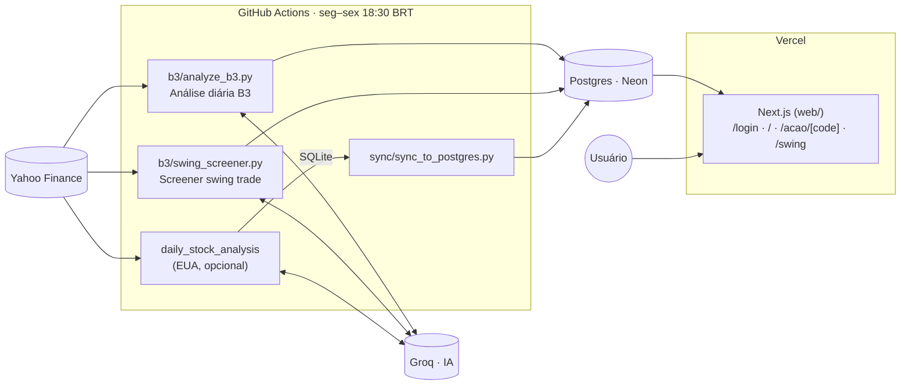
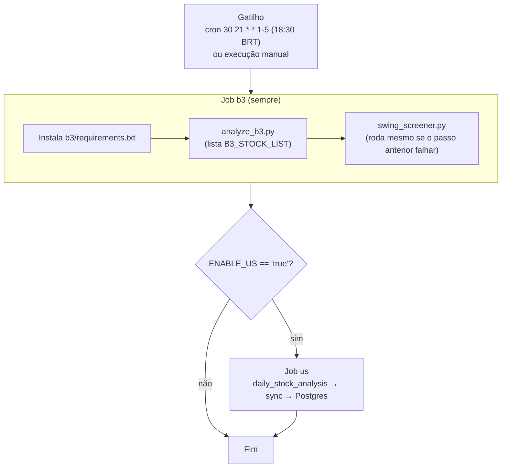
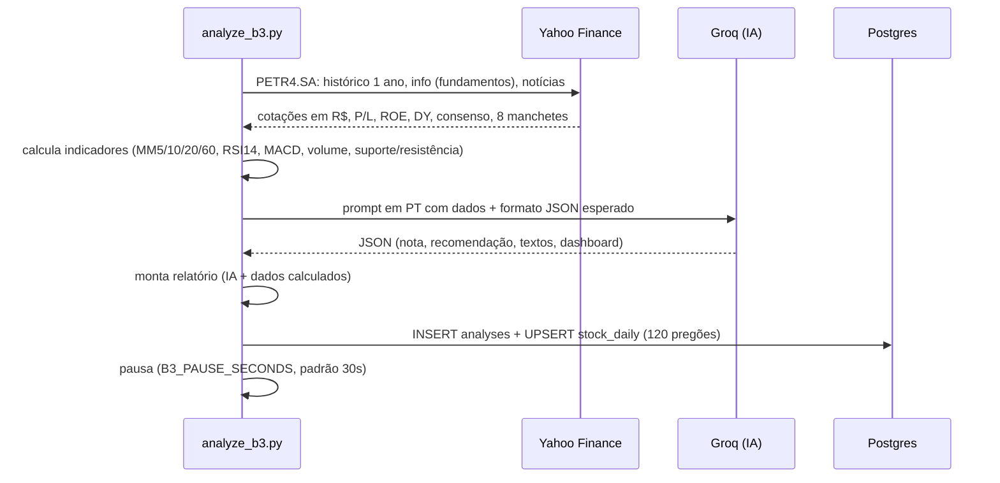
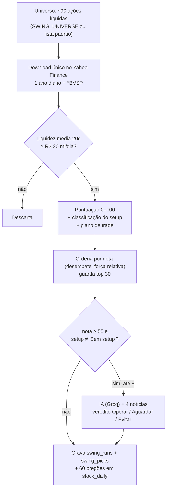
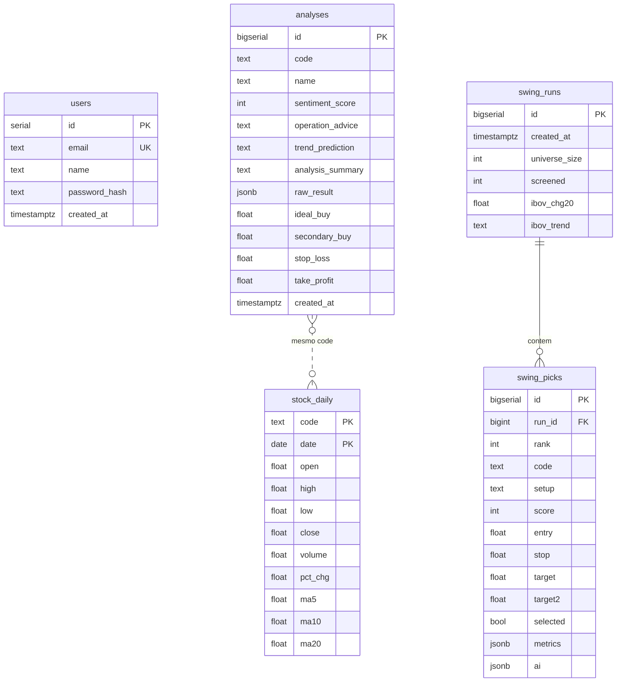
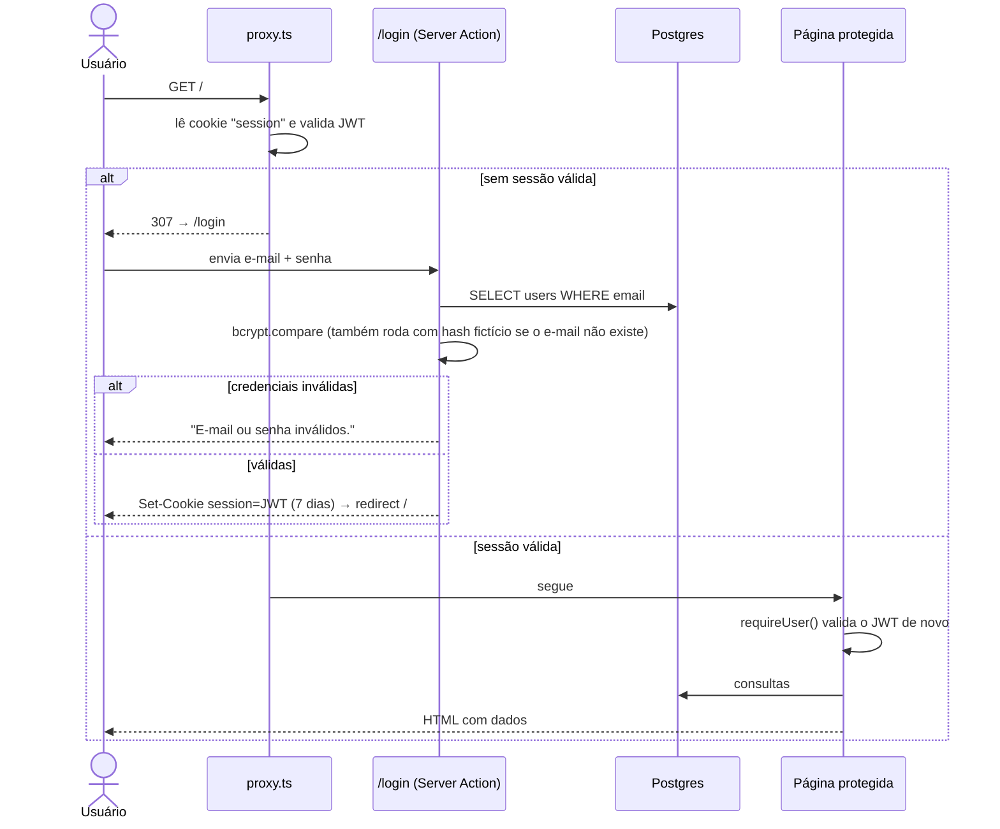
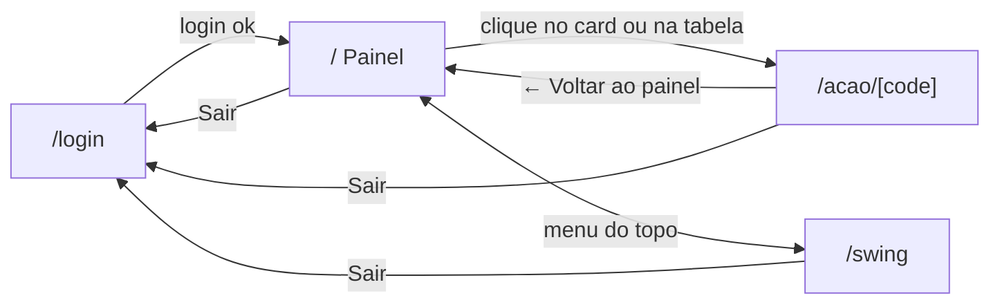

# Sistema de Análise de Ações: documentação

Este documento descreve o sistema atual: arquitetura, processos automáticos, fluxos e telas do app web, banco de dados e design system.

> Estado de referência: commit `15aa36b` (16/11/2026).

---

## Sumário

1. [Visão geral](#1-visão-geral)
2. [Arquitetura](#2-arquitetura)
3. [Processos automáticos (backend)](#3-processos-automáticos-backend)
   - 3.1 [Agendamento diário](#31-agendamento-diário-github-actions)
   - 3.2 [Análise diária da B3](#32-análise-diária-da-b3-b3analyze_b3py)
   - 3.3 [Screener de swing trade](#33-screener-de-swing-trade-b3swing_screenerpy)
   - 3.4 [Ações dos EUA (opcional)](#34-ações-dos-eua-opcional-daily_stock_analysis--sync)
4. [Banco de dados](#4-banco-de-dados)
5. [App web: autenticação e navegação](#5-app-web-autenticação-e-navegação)
6. [Telas](#6-telas)
   - 6.1 [Login](#61-login-login)
   - 6.2 [Painel do dia](#62-painel-do-dia-)
   - 6.3 [Detalhe da ação](#63-detalhe-da-ação-acaocode)
   - 6.4 [Swing Trade](#64-swing-trade-swing)
7. [Design system](#7-design-system)
8. [Configuração e deploy](#8-configuração-e-deploy)
9. [Operação e manutenção](#9-operação-e-manutenção)
10. [Limitações conhecidas](#10-limitações-conhecidas)

---

## 1. Visão geral

O sistema gera **todo dia útil**, de forma automática, análises de ações da bolsa brasileira (B3) e as exibe num **app web com login**.

| Entrega | O que o usuário vê |
|---|---|
| **Painel do dia** | A última análise de cada ação acompanhada: nota de 0 a 100, recomendação, tendência, pontos de compra/stop/alvo e resumo |
| **Detalhe da ação** | O relatório completo: conclusão, plano de operação, gráfico, indicadores, fundamentos, notícias, composição da nota e histórico |
| **Swing Trade** | Ranking das melhores oportunidades de swing trade entre cerca de 90 ações líquidas, com plano de entrada, stop e alvos validado por IA |

**Fontes e ferramentas:**

| Papel | Tecnologia |
|---|---|
| Dados de mercado | Yahoo Finance (biblioteca `yfinance`; ações da B3 com sufixo `.SA`) |
| Inteligência artificial | Groq, modelo `openai/gpt-oss-120b` (reserva: `openai/gpt-oss-20b`) |
| Banco de dados | PostgreSQL no Neon |
| Execução agendada | GitHub Actions |
| App web | Next.js 16 + React 19 + Tailwind CSS 4, hospedado na Vercel |
| Projeto de referência | [daily_stock_analysis](https://github.com/ZhuLinsen/daily_stock_analysis) (submódulo; usado para ações dos EUA e como modelo do formato de relatório) |

---

## 2. Arquitetura



**Princípio:** o processamento pesado (download de dados, cálculo de indicadores, chamadas de IA) roda **fora** da Vercel, no GitHub Actions. O app web só **lê** o Postgres, o que o deixa rápido, barato e sem risco de estourar os limites de tempo das funções serverless.

### Estrutura do repositório

| Caminho | Conteúdo |
|---|---|
| `b3/analyze_b3.py` | Análise diária das ações da B3 (Yahoo Finance + IA, relatório em português) |
| `b3/swing_screener.py` | Screener de swing trade (varredura quantitativa + validação por IA) |
| `b3/requirements.txt` | Dependências Python dos scripts da B3 |
| `daily_stock_analysis/` | Submódulo Git do projeto original (não editar) |
| `sync/sync_to_postgres.py` | Copia resultados do daily_stock_analysis (SQLite) para o Postgres |
| `db/schema.sql` | Schema do Postgres (idempotente) |
| `.github/workflows/daily-analysis.yml` | Agendamento diário |
| `web/` | App Next.js publicado na Vercel |
| `docs/SISTEMA.md` | Este documento |

---

## 3. Processos automáticos (backend)

### 3.1 Agendamento diário (GitHub Actions)

Arquivo: `.github/workflows/daily-analysis.yml`



- **Horário:** 18h30 de Brasília, depois do fechamento da B3.
- **Concorrência:** `concurrency: daily-analysis` impede duas execuções simultâneas.
- **Execução manual:** aba *Actions* → *Análise diária de ações* → *Run workflow*.

### 3.2 Análise diária da B3 (`b3/analyze_b3.py`)

Para cada ação da lista (`B3_STOCK_LIST` ou argumentos da linha de comando):



**Indicadores calculados pelo script** (não pela IA):

| Indicador | Cálculo |
|---|---|
| MM5, MM10, MM20, MM60 | Médias móveis simples do fechamento |
| Alinhamento de alta | MM5 > MM10 > MM20 |
| Desvio da MM5 | (preço ÷ MM5 − 1) × 100 |
| RSI 14 | Média exponencial de Wilder |
| MACD | EMA12 − EMA26; sinal = EMA9 do MACD |
| Volume relativo | Volume do dia ÷ média dos 5 dias anteriores |
| Suporte / resistência | Mínima / máxima dos últimos 20 pregões |
| Variações | 5, 20 e 60 dias; máxima e mínima de 52 semanas |

**O que a IA produz** (em português, formato compatível com o daily_stock_analysis):

- `sentiment_score` (0–100), `trend_prediction`, `operation_advice`, `action` (`buy`/`add`/`hold`/`watch`/`reduce`/`sell`/`avoid`), `confidence_level`
- Textos: resumo, pontos-chave, riscos, justificativa, perspectivas de curto e médio prazo, análises de tendência, técnica, médias, volume, fundamentos, setor, notícias e sentimento
- `dashboard`:
  - `core_conclusion`: sinal, frase-resumo e conselho para quem tem e para quem não tem a ação
  - `battle_plan`: pontos de entrada/stop/alvo, checklist e estratégia de posição
  - `intelligence`: notícias, catalisadores e alertas
  - `phase_decision`: ação imediata, condições a observar e próxima checagem
  - `signal_attribution`: peso de cada fator na nota

**Robustez:**
- Se o modelo principal atingir o limite da Groq, o script espera o tempo indicado (`retry-after`) e tenta de novo, até 3 vezes. Depois disso, passa para o modelo reserva.
- Uma ação com erro não interrompe as demais. O resumo final informa as que falharam.
- A IA recebe a instrução de não inventar dados e de usar "n/d" quando algo faltar.

### 3.3 Screener de swing trade (`b3/swing_screener.py`)



**Pontuação (máximo 100):**

| Grupo | Critério | Pontos |
|---|---|---|
| Tendência | Preço > MM50 | 10 |
| | MM20 > MM50 | 10 |
| | MM50 subindo (10 dias) | 5 |
| | Preço > MM200 | 5 |
| Momento | RSI entre 50 e 68 (entre 45–50 ou 68–72: 10) | 20 |
| | MACD positivo e acelerando (só acelerando: 5) | 10 |
| Força relativa | +1 ponto por p.p. acima do Ibovespa em 20 dias (máx. 10) | 10 |
| | Acima do Ibovespa em 60 dias | 10 |
| Setup | Rompimento ou pullback (só tendência de alta: 8) | 20 |
| Penalidades | RSI > 75 | −15 |
| | Preço > 8% acima da MM20 | −15 |

**Setups detectados:**

| Setup | Regra |
|---|---|
| Rompimento com volume | Fechamento acima da máxima dos 20 pregões anteriores **e** volume ≥ 1,3× a média de 20 dias |
| Pullback na MM20 | Tendência de alta (preço e MM20 acima da MM50), preço entre −1% e +3% da MM20 e mínima tocando a MM20 nos últimos 3 pregões |
| Tendência de alta | Tendência de alta e preço acima da EMA9 |
| Sem setup | Nenhum dos anteriores (não vai para a IA) |

**Plano de trade:**

- **Entrada:** último fechamento.
- **Stop:** o **maior** entre a mínima dos últimos 10 pregões e (preço − 2 × ATR14), ou seja, o mais próximo do preço. Se ficar a menos de 1,5% do preço, usa preço − 1,5 × ATR.
- **Alvo 1:** entrada + 2 × risco (relação 1:2). **Alvo 2:** entrada + 3 × risco (1:3).
- **Alerta:** stop a mais de 8% do preço gera aviso para reduzir a posição.

**Saída da IA (por ação selecionada):** `veredito`, `confianca`, `tese`, `gatilho_entrada`, `gestao`, `horizonte`, `riscos[]`, `checklist[]` e as notícias consideradas.

### 3.4 Ações dos EUA (opcional: `daily_stock_analysis` + `sync`)

Desligado por padrão. Com a variável `ENABLE_US=true`, o job `us`:

1. Roda o projeto original (`python main.py --no-market-review --no-notify`) com a Groq como provedor.
2. O projeto grava em SQLite (`daily_stock_analysis/data/stock_analysis.db`).
3. `sync/sync_to_postgres.py` copia `analysis_history` → `analyses` e `stock_daily` → `stock_daily` (upsert; não duplica).

> O projeto original não suporta a B3; por isso existe o analisador próprio da seção 3.2.

---

## 4. Banco de dados

Arquivo: `db/schema.sql` (idempotente: `CREATE ... IF NOT EXISTS`). É aplicado automaticamente pelos scripts e pelo `npm run create-user`.



| Tabela | Escrita por | Lida por | Observação |
|---|---|---|---|
| `users` | `npm run create-user` | Login | Senha com bcrypt (custo 12) |
| `analyses` | `analyze_b3.py`, `sync_to_postgres.py` | Painel, Detalhe | Uma linha por análise; `UNIQUE (code, created_at)`; relatório completo em `raw_result` (JSONB) |
| `stock_daily` | os três scripts | Gráfico e minigráficos | Chave `(code, date)`; upsert |
| `swing_runs` | `swing_screener.py` | Swing Trade | Uma linha por varredura |
| `swing_picks` | `swing_screener.py` | Swing Trade | Top 30 da varredura; `selected = true` para as revisadas pela IA |

**Diferenciação de mercado:** análises da B3 têm `raw_result.currency = "BRL"` e `raw_result.market = "br"`. O app usa isso para exibir **R$**; sem esse campo, exibe **US$**.

---

## 5. App web: autenticação e navegação

### 5.1 Mapa de rotas

| Rota | Tipo | Protegida | Conteúdo |
|---|---|---|---|
| `/login` | Estática | Não | Formulário de login |
| `/` | Prerender parcial | Sim | Painel do dia |
| `/acao/[code]` | Prerender parcial | Sim | Detalhe da ação |
| `/swing` | Prerender parcial | Sim | Swing Trade |

*Prerender parcial:* o esqueleto da página é estático e os dados chegam por streaming dentro de `<Suspense>`, como exige o modo `cacheComponents` do Next.js 16.

### 5.2 Fluxo de autenticação



**Detalhes de segurança:**

| Item | Implementação |
|---|---|
| Sessão | JWT HS256 assinado com `AUTH_SECRET` (`jose`), expira em 7 dias |
| Cookie | `session`, `httpOnly`, `sameSite=lax`, `secure` em produção |
| Dupla checagem | `proxy.ts` faz a verificação rápida (só cookie); cada página chama `requireUser()` antes de ler dados |
| Login já autenticado | Acessar `/login` com sessão válida redireciona para `/` |
| Enumeração de e-mails | Mesma mensagem e mesmo custo de bcrypt para e-mail inexistente ou senha errada |
| Logout | Server Action `logout` apaga o cookie e redireciona para `/login` |
| Cadastro | Fechado: usuários são criados por `npm run create-user` |

### 5.3 Navegação



O cabeçalho (`Header`) aparece em todas as telas protegidas, com logo, menu (**Painel** · **Swing Trade**, com destaque no item ativo), e-mail do usuário e botão **Sair**.

---

## 6. Telas

### 6.1 Login (`/login`)

```
┌──────────────────────────────────────────┐
│                   📈                     │
│            Análise de Ações              │
│      Entre para ver o painel diário      │
│  ┌────────────────────────────────────┐  │
│  │ E-mail   [____________________]    │  │
│  │ Senha    [____________________]    │  │
│  │ [ ! E-mail ou senha inválidos. ]   │  │
│  │ [           Entrar             ]   │  │
│  └────────────────────────────────────┘  │
└──────────────────────────────────────────┘
```

- Centralizado vertical e horizontalmente, largura máxima de 384 px (`max-w-sm`).
- Botão verde (`emerald-600`) mostra "Entrando…" e fica desabilitado durante o envio (`useActionState`).
- Erro exibido em caixa vermelha translúcida com `role="alert"`.
- Mensagens: "Informe e-mail e senha." / "E-mail ou senha inválidos."

### 6.2 Painel do dia (`/`)

**Fonte de dados:** última análise de cada ação (`DISTINCT ON (code)` em `analyses`, ordenada pela nota) + 30 últimos fechamentos de cada ação (`stock_daily`).

```
┌ Header ─────────────────────────────────────────────────────────────┐
│ Painel do dia                               Atualizado em dd/mm hh:mm│
│ ┌Ações analisadas┐┌Nota média┐┌Maior nota┐┌Menor nota┐              │
│ (Comprar: 3) (Manter: 2) (Observar: 7) (Reduzir: 2)   ← contagem    │
│ ┌Card PETR4──────────┐┌Card WEGE3─────────┐┌Card ...──────────┐     │
│ │PETR4      R$ 44,02 ││                   ││                  │     │
│ │Petrobras    -0,98% ││                   ││                  │     │
│ │~~~ minigráfico ~~~ ││                   ││                  │     │
│ │[55] Lateral [Manter]│                   ││                  │     │
│ │Tendência·Confiança·Médias               ││                  │     │
│ │Resumo (3 linhas)   ││                   ││                  │     │
│ │Compra Stop Alvo    ││                   ││                  │     │
│ │Suporte Resist. Vol.││                   ││                  │     │
│ │Posição sugerida    ││                   ││                  │     │
│ └────────────────────┘└───────────────────┘└──────────────────┘     │
│ ┌Comparativo (tabela)──────────────────────────────────────────────┐│
│ │Ação Preço Dia Mín–Máx Nota Recomendação Tendência Compra Stop    ││
│ │Alvo Potencial                                                    ││
│ └──────────────────────────────────────────────────────────────────┘│
│ Aviso: conteúdo gerado por IA, não é recomendação de investimento    │
└─────────────────────────────────────────────────────────────────────┘
```

| Bloco | Conteúdo | Origem |
|---|---|---|
| Resumo (KPIs) | Quantidade de ações, nota média (com faixa colorida), maior e menor nota | Calculado no servidor |
| Contagem por ação | Quantas estão em Comprar / Manter / Observar / Reduzir / Vender | `raw_result.action` |
| Card | Código, nome, preço e variação do dia (verde/vermelho), minigráfico de 30 dias, nota, ação recomendada, etiquetas (tendência, confiança, alinhamento de médias), frase-resumo, compra/stop/alvo, suporte/resistência, volume, posição sugerida | `analyses` + `raw_result` + `stock_daily` |
| Comparativo | Tabela com todas as ações; coluna **Potencial** = (alvo − preço) ÷ preço | Idem |
| Estado vazio | "Nenhuma análise ainda" com instrução para rodar o workflow | — |

**Grade responsiva dos cards:** 1 coluna (celular), 2 a partir de `sm` (640 px), 3 a partir de `xl` (1280 px). A tabela rola na horizontal em telas estreitas (largura mínima de 760 px).

**Interação:** o card inteiro e o código na tabela levam a `/acao/[code]`.

### 6.3 Detalhe da ação (`/acao/[code]`)

**Fonte de dados:** até 30 análises da ação (a mais recente é a principal) + 60 pregões de `stock_daily`. Código inexistente → página 404.

Ordem das seções:

| # | Seção | Conteúdo |
|---|---|---|
| 1 | Cabeçalho | Código, nome, data/hora da análise, modelo de IA usado; preço (R$/US$) e variação |
| 2 | Conclusão (2/3 da largura) | Nota grande + faixa, ação recomendada (pílula colorida), recomendação, tendência, confiança; frase-resumo em destaque; resumo completo; caixas "Se você não tem a ação" / "Se você já tem a ação" |
| 3 | Pontos de entrada e saída (1/3) | Compra ideal, compra secundária, stop loss, alvo; potencial até o alvo (verde) e risco até o stop (vermelho); posição sugerida, plano de entrada, controle de risco |
| 4 | Gráfico (2/3) | Linha de fechamento + MM5 + MM20 dos últimos pregões, eixo com 3 valores e datas inicial/final, legenda |
| 5 | Pregão e Indicadores (1/3) | Abertura, máxima, mínima, fechamento anterior, amplitude, volume; MM5/10/20, desvio da MM5, suporte, resistência, força da tendência, volume. **B3:** RSI, MACD, MM60, variações de 5/20/60 dias, máxima/mínima de 52 semanas |
| 6 | Checklist · O que fazer agora · Composição da nota | Checklist da operação; ação imediata, próxima checagem, condições a acompanhar; barras com o peso de técnicos/fundamentos/mercado/notícias, sinal mais forte de alta e de baixa, ajuste de nota (quando houver) |
| 7 | Fundamentos e Manchetes (**só B3**) | Setor, indústria, valor de mercado, P/L, P/L projetado, P/VP, ROE, dividend yield, consenso dos analistas, preço-alvo médio; lista de manchetes com data e fonte |
| 8 | Notícias e resultados · Catalisadores e alertas | Últimas notícias, sentimento, perspectiva de resultados; catalisadores positivos (verde), alertas de risco (vermelho), limitações dos dados |
| 9 | Textos do relatório | Até 16 cartões: pontos-chave, justificativa, riscos, curto prazo, médio prazo, tendência, técnica, médias, volume, padrões de candles, fundamentos, destaques, setor, notícias, sentimento, temas em alta. Seções vazias não aparecem |
| 10 | Histórico de análises | Tabela: data, nota, recomendação, tendência, compra, stop, alvo |

**Regra geral:** todo campo é opcional. Blocos sem dados são omitidos, e valores ausentes aparecem como "—". Por isso a mesma tela serve aos relatórios da B3 e dos EUA, que têm campos diferentes.

### 6.4 Swing Trade (`/swing`)

**Fonte de dados:** a varredura mais recente (`swing_runs`) com seus 30 itens (`swing_picks`) + 60 pregões por ação para os minigráficos.

```
┌ Header (Swing Trade ativo) ─────────────────────────────────────────┐
│ Swing Trade · B3                       Varredura de dd/mm/aaaa hh:mm│
│ ┌Ações varridas┐┌Passaram no filtro┐┌Avaliadas pela IA┐┌Ibovespa┐  │
│ ▸ Como as ações são escolhidas (expansível)                         │
│ ┌Card #1 CXSE3 [Pullback na MM20]──────┐┌Card #2 ...──────────────┐ │
│ │Caixa Seguridade          [Aguardar] ││                          │ │
│ │                 Nota 90 · conf. média││                          │ │
│ │~~~~~~~~~~ minigráfico 60d ~~~~~~~~~~││                          │ │
│ │[Entrada][Stop -5,9%][Alvo1 +12%][Alvo2]                         │ │
│ │RSI · ATR · vs Ibov · Liquidez · Volume · dist. MM20 · horizonte │ │
│ │Tese (IA)                            ││                          │ │
│ │[Gatilho de entrada][Gestão]         ││                          │ │
│ │▸ Checklist, riscos e sinais         ││                          │ │
│ └─────────────────────────────────────┘└──────────────────────────┘ │
│ ┌Ranking completo (top 30) ───────────────────────────────────────┐ │
│ │# Ação Setup Nota Preço Stop Alvo2R Risco RSI vsIbov Liquidez IA │ │
│ └─────────────────────────────────────────────────────────────────┘ │
│ Aviso de risco                                                      │
└─────────────────────────────────────────────────────────────────────┘
```

| Bloco | Conteúdo |
|---|---|
| KPIs | Ações varridas, quantas passaram no filtro de liquidez, quantas a IA avaliou (e quantas com "Operar"), variação do Ibovespa em 20 dias e situação frente à MM50 |
| "Como as ações são escolhidas" | Elemento `<details>` com os critérios de pontuação, stop, alvos, penalidades e a regra de **tamanho da posição**: quantidade = (capital × 1%) ÷ (entrada − stop) |
| Card da ação selecionada | Posição no ranking, código, setup, nome, veredito da IA (verde **Operar**, âmbar **Aguardar**, vermelho **Evitar**), nota e confiança, minigráfico, 4 níveis (entrada, stop, alvo 1, alvo 2 com %), etiquetas técnicas, tese, gatilho de entrada, gestão. A seção expansível mostra checklist, riscos, sinais a favor, alertas técnicos e notícias consideradas |
| Ranking completo | As 30 melhores notas, incluindo as que não foram à IA (coluna IA com "—") |
| Estado vazio | "Nenhuma varredura ainda" |

Cards em 1 coluna até `lg` (1024 px) e em 2 colunas acima disso.

---

## 7. Design system

Implementado em `web/src/app/globals.css` (tokens + classes utilitárias) sobre **Tailwind CSS 4**, com componentes em `web/src/components/`.

### 7.1 Princípios

1. **Dados em primeiro lugar:** números em fonte monoespaçada com algarismos tabulares, para que colunas e valores fiquem alinhados.
2. **Cor com significado:** verde = alta/positivo, vermelho = baixa/negativo/risco, âmbar = neutro/cautela. A cor nunca é decorativa.
3. **Superfícies discretas:** cartões com borda fina e sem sombra; o destaque vem do conteúdo.
4. **Tema claro e escuro automático:** segue a preferência do sistema operacional (`prefers-color-scheme`).
5. **Degradação elegante:** campos ausentes viram "—" e blocos vazios não aparecem.

### 7.2 Tokens de cor

| Token | Uso | Claro | Escuro |
|---|---|---|---|
| `--background` / `bg-background` | Fundo da página, campos de formulário | `#f7f8fa` | `#0b0e13` |
| `--foreground` / `text-foreground` | Texto principal | `#14171c` | `#e8ebf0` |
| `--surface` / `bg-surface` | Cartões | `#ffffff` | `#12161d` |
| `--surface-2` / `bg-surface-2` | Etiquetas, áreas internas, hover de linha | `#eef0f3` | `#1b2029` |
| `--line` / `border-line` | Bordas e divisores | `#e2e5ea` | `#232a35` |
| `--muted` / `text-muted` | Texto secundário, rótulos | `#5d6673` | `#8b95a5` |

**Cores semânticas (iguais nos dois temas):**

| Classe de tom | Cor | Significado |
|---|---|---|
| `.tone-strong-up` | `#059669` | Forte alta · Comprar · Operar |
| `.tone-up` | `#10b981` | Alta · Manter |
| `.tone-neutral` | `#d97706` | Lateral · Observar · Aguardar |
| `.tone-down` | `#dc2626` | Baixa · Reduzir · Vender · Evitar |

Cada tom define `--tone`, aplicado por:
- `.tone-bg`: fundo com 15% da cor (`color-mix`) e texto na cor cheia (pílulas, selos de nota);
- `.tone-fg`: só o texto na cor.

**Cores pontuais do Tailwind:**

| Uso | Classe / valor |
|---|---|
| Botão primário | `bg-emerald-600`, hover `emerald-500` |
| Variação positiva / potencial | `text-emerald-500` |
| Variação negativa / risco | `text-red-500` |
| Foco de campo | borda `emerald-500` + anel `emerald-500/20` |
| Gráfico: fechamento / MM5 / MM20 | `emerald-500` / `sky-400` / `amber-400` |
| Minigráfico | `#10b981` se subiu no período, `#ef4444` se caiu (área com 10% de opacidade) |
| Barras de composição da nota | `bg-emerald-500` sobre trilho `bg-surface-2` |

### 7.3 Tipografia

| Papel | Fonte | Classes |
|---|---|---|
| Texto geral | Geist Sans (`--font-sans`) | padrão do `body` |
| Números, códigos de ação, preços | Geist Mono (`--font-mono`) | `font-mono tabular-nums` |
| Título de página | Geist Sans | `text-2xl font-semibold tracking-tight` |
| Código da ação no detalhe | Geist Mono | `text-3xl font-semibold` |
| Título de cartão/seção | Geist Sans | `text-sm font-semibold` |
| Rótulos | Geist Sans | `text-xs text-muted` |
| Corpo de relatório | Geist Sans | `text-sm leading-relaxed`, `whitespace-pre-line` |

Idioma do documento: `pt-BR`.

### 7.4 Espaçamento, forma e layout

| Elemento | Valor |
|---|---|
| Largura do conteúdo | `max-w-7xl` (1280 px), centralizado |
| Margem lateral | `px-4` (16 px) |
| Respiro vertical da página | `py-8` |
| Espaço entre cartões | `gap-4` (KPIs: `gap-3`) |
| Padding de cartão | `p-5` (KPIs: `p-4`) |
| Raio: cartões | `rounded-xl` |
| Raio: campos, botões, níveis | `rounded-lg` |
| Raio: etiquetas | `rounded-md` |
| Raio: pílulas e contadores | `rounded-full` |

**Pontos de quebra (Tailwind):** `sm` 640 px · `md` 768 px · `lg` 1024 px · `xl` 1280 px. Tabelas largas ficam dentro de `overflow-x-auto` com largura mínima, para rolar na horizontal no celular sem quebrar a página.

### 7.5 Classes de componente (`globals.css`)

| Classe | Definição | Uso |
|---|---|---|
| `.card` | `rounded-xl border border-line bg-surface` | Todo cartão do sistema |
| `.input` | borda `line`, fundo `background`, `px-3 py-2 text-sm`, foco verde com anel | Campos do login |

### 7.6 Componentes React

**Compartilhados** (`web/src/components/`):

| Componente | Props | Descrição |
|---|---|---|
| `Header` | `userName`, `active?` (`"/"` \| `"/swing"`) | Barra superior: logo, menu com item ativo, usuário, botão Sair (Server Action) |
| `ScoreBadge` | `score`, `large?` | Selo com a nota (fundo do tom) + rótulo da faixa. Tamanho normal 40×32 px; grande 64×56 px |
| `Sparkline` | `values[]` | Minigráfico SVG (área + linha), cor pela direção do período, sem eixos; 40 px de altura e largura total |
| `PriceChart` | `bars[]` | Gráfico SVG responsivo (720×220 de viewBox): fechamento, MM5, MM20, 3 linhas de grade tracejadas, datas nas pontas, legenda |
| `PageSkeleton` | — | Esqueleto pulsante (cabeçalho, título, 6 cartões) exibido enquanto os dados carregam |

**Locais** (definidos dentro das páginas):

| Componente | Página | Descrição |
|---|---|---|
| `Stat` | Painel | Par rótulo/valor monoespaçado nos cards |
| `Panel` | Detalhe | Cartão com título `text-sm font-semibold` |
| `Field` | Detalhe | Rótulo + texto; não renderiza se vazio |
| `Advice` | Detalhe | Caixa com borda para conselho de posição |
| `KeyValues` | Detalhe | Grade de 2 colunas rótulo/valor |
| `List` | Detalhe | Lista com marcador colorido pelo tom (verde, vermelho, neutro); "Nenhum identificado." quando vazia |
| `Kpi` | Swing | Cartão de indicador com dica opcional |
| `Level` | Swing | Bloco de preço (entrada, stop, alvo) com percentual colorido |
| `Chip` | Swing | Etiqueta `bg-surface-2` |
| `Box` | Swing | Caixa com borda (gatilho, gestão) |
| `ListBlock` | Swing | Lista com título (checklist, riscos, sinais, notícias) |

### 7.7 Padrões de formatação (`web/src/lib/format.ts`)

| Função | Exemplo | Regra |
|---|---|---|
| `fmtPrice` | `44,02` | 2 casas, padrão pt-BR |
| `fmtMoney` | `R$ 44,02` / `US$ 352,78` | R$ quando `raw_result.currency = "BRL"` |
| `fmtPct` | `+1,25%` / `-0,98%` | 2 casas, sinal explícito para positivos |
| `fmtCompact` | `601,5 bi` / `25,3 mi` | Notação compacta pt-BR |
| `fmtDateTime` | `16/11/2026, 18:19` | Fuso `America/Sao_Paulo` |
| `scoreTone` | 78 → Forte alta | >70 Forte alta · >60 Alta · 40–60 Lateral · <40 Baixa |
| `actionTone` | `watch` → Observar | buy/add → Comprar · hold → Manter · watch → Observar · reduce → Reduzir · sell/avoid → Vender / evitar · alert → Alerta |
| `confidenceLabel` | `low` → Baixa | Também converte os rótulos chineses 高/中/低 |
| `recommendationLabel` | `strong_buy` → Compra forte | Consenso dos analistas do Yahoo |
| Valor ausente | `—` | Em todas as funções |

### 7.8 Estados de interface

| Estado | Tratamento |
|---|---|
| Carregando | `PageSkeleton` (via `<Suspense>`) |
| Sem dados | Cartão central com título e orientação |
| Campo ausente | "—" ou bloco omitido |
| Hover | Cartões ganham borda verde translúcida; linhas de tabela ganham fundo `surface-2`; botões clareiam |
| Envio de formulário | Botão desabilitado com opacidade 60% e texto "Entrando…" |
| Erro de login | Caixa vermelha translúcida com `role="alert"` |
| Ação ou rota inexistente | 404 padrão do Next.js |

### 7.9 Acessibilidade

- `lang="pt-BR"` no documento.
- Gráficos com `role="img"` e `aria-label`; minigráficos decorativos com `aria-hidden`.
- Esqueleto com `aria-busy` e `aria-label="Carregando"`.
- Cor nunca é o único indicador: notas, vereditos e variações também têm texto ou sinal (+/−).
- Campos de login com `<label>` associado e `autocomplete` (`email`, `current-password`).

---

## 8. Configuração e deploy

### 8.1 Variáveis e segredos

| Onde | Nome | Obrigatório | Descrição |
|---|---|---|---|
| GitHub → Secrets | `GROQ_API_KEY` | Sim | Chave da Groq (console.groq.com/keys) |
| GitHub → Secrets | `DATABASE_URL` | Sim | Connection string do Neon |
| GitHub → Variables | `B3_STOCK_LIST` | Não | Ações do painel, sem `.SA` (padrão: PETR4, VALE3, ITUB4, BBDC4, BBAS3, ABEV3, WEGE3, B3SA3, ITSA4, RENT3, SUZB3, MGLU3) |
| GitHub → Variables | `SWING_TOP_N` | Não | Quantas ações vão para a IA no swing (padrão 8) |
| GitHub → Variables | `ENABLE_US` | Não | `true` para rodar também as ações dos EUA |
| GitHub → Variables | `STOCK_LIST` | Não | Ações dos EUA (padrão: AAPL, MSFT, NVDA, GOOGL, AMZN) |
| GitHub → Secrets | `TAVILY_API_KEYS` / `SERPAPI_API_KEYS` | Não | Busca de notícias para a análise dos EUA |
| Vercel → Environment Variables | `DATABASE_URL` | Sim | Mesmo valor do GitHub |
| Vercel → Environment Variables | `AUTH_SECRET` | Sim | Mínimo de 32 caracteres; gere com `node -e "console.log(require('crypto').randomBytes(32).toString('base64url'))"` |

Variáveis de ajuste fino dos scripts (opcionais): `GROQ_MODELS`, `B3_PAUSE_SECONDS`, `SWING_UNIVERSE`, `SWING_MIN_FIN_VOLUME`, `SWING_MIN_SCORE`, `SWING_PAUSE_SECONDS`.

### 8.2 Deploy na Vercel

1. *Add New → Project* → importar `francooo/appdeacoes`.
2. **Root Directory:** `web`.
3. Cadastrar `DATABASE_URL` e `AUTH_SECRET`.
4. *Deploy*. O framework (Next.js) é detectado automaticamente.

### 8.3 Rodar localmente

```powershell
# App web
cd web
copy .env.example .env.local        # preencher DATABASE_URL e AUTH_SECRET
npm install
npm run create-user -- email@exemplo.com "Nome" "senha"
npm run dev                          # http://localhost:3000

# Análises (na raiz do repositório)
pip install -r b3/requirements.txt
$env:GROQ_API_KEY = "..."; $env:DATABASE_URL = "..."
python b3/analyze_b3.py PETR4 VALE3  # ações específicas
python b3/swing_screener.py          # varredura de swing trade
```

---

## 9. Operação e manutenção

| Tarefa | Como fazer |
|---|---|
| Criar usuário ou trocar senha | `cd web` → `npm run create-user -- email "Nome" "nova-senha"` (atualiza se o e-mail já existe) |
| Mudar ações do painel | Variável `B3_STOCK_LIST` no GitHub |
| Rodar fora do horário | GitHub → Actions → *Análise diária de ações* → *Run workflow* |
| Ver logs de uma execução | GitHub → Actions → execução → job `b3` |
| Ticker mudou de código | Atualizar `DEFAULT_UNIVERSE` em `b3/swing_screener.py` ou definir `SWING_UNIVERSE`. Os códigos sem dados aparecem no log como "No data found" |
| Atualizar o projeto original | `git submodule update --remote daily_stock_analysis` e commit |
| Trocar o modelo de IA | Variável `GROQ_MODELS` (lista separada por vírgulas, em ordem de preferência) |

**Limites da Groq (plano gratuito):** cerca de **8.000 tokens por minuto por modelo**. A análise da B3 usa entre 4.000 e 6.000 tokens por ação. A pausa entre ações, a espera automática ao receber erro 429 e o modelo reserva mantêm a execução dentro do limite. Para listas grandes, considere o plano pago da Groq.

---

## 10. Limitações conhecidas

- **Dados com atraso:** o Yahoo Finance pode atrasar ou omitir campos (fundamentos, notícias). Por isso as análises rodam depois do fechamento.
- **Notícias em inglês:** as manchetes do Yahoo para ações brasileiras costumam ser de veículos internacionais.
- **Sem backtest:** os critérios do screener de swing trade são regras técnicas clássicas, mas a taxa de acerto histórica ainda não foi medida.
- **Universo fixo:** a lista do screener é mantida manualmente e precisa de revisão quando o Ibovespa muda.
- **IA pode errar:** os textos são gerados por modelo de linguagem a partir dos dados fornecidos e podem conter imprecisões. O sistema é para estudo e **não é recomendação de investimento**.
- **Projeto original sem suporte à B3:** por isso a B3 usa o analisador próprio. O daily_stock_analysis segue disponível para ações dos EUA.
